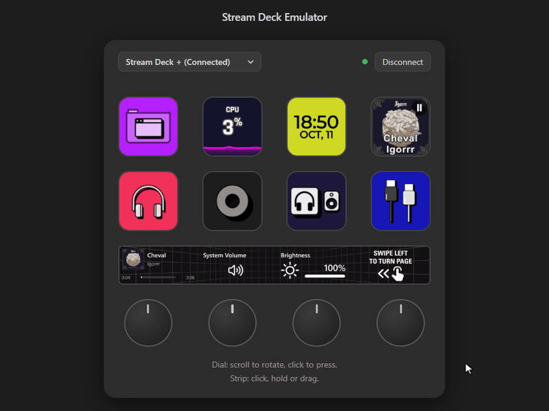

English | [Русский](README.ru.md)

# Stream Deck Emulator

> [!WARNING]
> This is an unofficial project. It is not affiliated with, endorsed by or supported by Elgato or Corsair. Stream Deck is a trademark of Corsair Memory, Inc.

<p align="center">
  
</p>


A virtual Stream Deck for the real Stream Deck application. The emulator presents itself to Windows as a USB device, so the Stream Deck app, your plugins and your profiles behave exactly as they do with hardware.

It is built for plugin developers who do not own every model.

## Supported Models

| Model | Id | Emulated |
|---|---|---|
| Stream Deck + | `plus` | 8 keys, 4 dials, touch strip |
| Stream Deck Neo | `neo` | 8 keys, 2 touch keys, info screen |
| Stream Deck MK.2 | `mk2` | 15 keys |

## Features

- **Browser UI**: Click keys, scroll and press dials, click, hold or drag on the touch strip, and see what the app draws on every screen.
- **Several Devices at Once**: Connect and disconnect each model on its own. The others keep working.
- **Headless Start**: Connect models from the command line without opening the browser.

## Requirements

- **Operating System**: Windows 10 or 11
- **USB/IP Client**: [usbip-win2](https://github.com/vadimgrn/usbip-win2), which creates the virtual USB device (tested with 0.9.7.8)
- **Elgato Stream Deck Software**

## Quick Start

1. Install usbip-win2.
2. Download `stream-deck-emulator-windows-amd64.exe` from the [latest release](https://github.com/valentderah/stream-deck-emulator/releases/latest) and run it.
3. Open <http://127.0.0.1:8484>.
4. Pick a model in the list above the keys and press **Connect**. It appears in the Stream Deck app within a few seconds.
5. Press **Disconnect** to unplug it. The Stream Deck app remembers the device and its profiles, as it does with real hardware.

## Limitations

- The Neo is implemented from open-source protocol descriptions and has not been compared with a real device. Report anything the app shows differently.

- The web UI has no authentication. Keep it on a loopback address; anyone who can open the page can press your keys.

## Reference

<details>
<summary>Command-line flags</summary>

| Flag | Default | Meaning |
|---|---|---|
| `-usbip` | `127.0.0.1:3240` | USB/IP listen address |
| `-ui` | `127.0.0.1:8484` | Web UI listen address |
| `-usbip-cli` | search | Path of the `usbip` client. By default the emulator looks on `PATH`, then in `C:\Program Files\USBip`. |
| `-connect` | none | Models to connect at start, for example `-connect plus,neo`. |
| `-version` | | Print the version and exit. |

</details>

<details>
<summary>HTTP API</summary>

The web UI talks to the emulator over HTTP, and scripts can do the same: press keys, turn dials and read back what the app drew. The API is not stable yet.

`{id}` is a model id: `plus`, `neo` or `mk2`. The examples use a POSIX shell and the default address.

| Request | Result |
|---|---|
| `GET /api/devices` | Models with their layout and connection state |
| `POST /api/devices/{id}/connect` | Plug the device in |
| `POST /api/devices/{id}/disconnect` | Unplug the device |
| `POST /api/devices/{id}/input` | Press a key or a dial, turn a dial, touch the strip |
| `GET /api/devices/{id}/key/{index}` | Key image, JPEG |
| `GET /api/devices/{id}/strip` | Touch strip image, PNG |
| `GET /api/devices/{id}/screen` | Info screen image, JPEG |
| `GET /api/events` | Server-sent events about display and connection changes |

A successful `POST` answers `204`. An error answers with a JSON body such as `{"code":"unsupported_input"}`. A key or screen the app has not drawn yet answers `204` without a body.

Keys are numbered from 0, left to right and top to bottom. The touch keys of the Neo follow the regular keys: 8 and 9. Dials are numbered from 0, left to right.

Press and release key 0:

```bash
curl -X POST http://127.0.0.1:8484/api/devices/plus/input -d '{"type":"key","index":0,"down":true}'
curl -X POST http://127.0.0.1:8484/api/devices/plus/input -d '{"type":"key","index":0,"down":false}'
```

Turn dial 1 by three ticks, then press it. A negative `ticks` turns the other way.

```bash
curl -X POST http://127.0.0.1:8484/api/devices/plus/input -d '{"type":"dialRotate","index":1,"ticks":3}'
curl -X POST http://127.0.0.1:8484/api/devices/plus/input -d '{"type":"dialPress","index":1,"down":true}'
curl -X POST http://127.0.0.1:8484/api/devices/plus/input -d '{"type":"dialPress","index":1,"down":false}'
```

Touch the strip. `kind` is `1` for a tap, `2` for a long press and `3` for a drag from `x`, `y` to `x2`, `y2`. Coordinates are in strip pixels, 800 by 100 on the Stream Deck +.

```bash
curl -X POST http://127.0.0.1:8484/api/devices/plus/input -d '{"type":"touch","kind":1,"x":100,"y":50}'
curl -X POST http://127.0.0.1:8484/api/devices/plus/input -d '{"type":"touch","kind":3,"x":100,"y":50,"x2":400,"y2":50}'
```

Save what the app drew on key 0:

```bash
curl -o key0.jpg http://127.0.0.1:8484/api/devices/plus/key/0
```

Images are returned as the app sent them. The Neo and the MK.2 receive theirs rotated by 180 degrees; `rotated` in `GET /api/devices` tells which models do.

</details>

<details>
<summary>Building from source</summary>

Building requires Go 1.27 or higher.

```
go build -trimpath -o bin/emulator.exe ./cmd/emulator
bin\emulator.exe
```

</details>